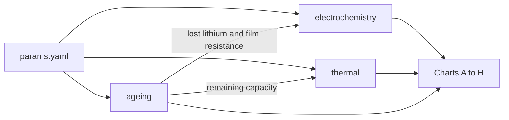

# space-power-sims

[](https://github.com/theonlyallana/space-power-sims/actions/workflows/ci.yml)

Small, fully explained Python simulations of batteries and power systems for space. One repository, one licence, one set of tests. One model, added to a layer at a time. By April it is one lunar outpost power model. November is the cold electrochemistry and the night. December is ageing.

Personal project using only public data. Not affiliated with or endorsed by my employer.

## Model so far



`safety`, `pack`, `variation` and `mission` are named on the scenario runner and are not drawn yet. Switching one of them on raises an error, so a later month cannot silently no-op.

## Layers

| Layer | Month | Question answered | Headline chart | Link |
|---|---|---|---|---|
| Electrochemistry | November 2026 | When does a cold charge plate lithium, and how much energy comes back out? | [A](lunar_power/figures/A_plated_lithium.png) plating, [B](lunar_power/figures/B_discharge_curves.png) discharge | [Explained](lunar_power/EXPLAINED.md) |
| Thermal | November 2026 | What does a lunar night cost in heater energy, and does keep-warm beat hibernation? | [C](lunar_power/figures/C_heater_energy.png) heater energy, [D](lunar_power/figures/D_keep_warm_vs_hibernate.png) keep-warm against hibernate | [Explained](lunar_power/EXPLAINED.md) |
| Ageing | December 2026 | How many cycles does an orbit demand, how does the surface film grow, where does radiation sit, and what do three depths of discharge leave? | [E](lunar_power/figures/E_sixteen_cycles_a_day.png) orbit, [F](lunar_power/figures/F_sei_growth.png) film, [G](lunar_power/figures/G_radiation_concept.png) radiation, [H](lunar_power/figures/H_fade_three_depths.png) fade | [Explained](lunar_power/EXPLAINED.md) |

## The posts

Cold, life, safety, mass, trust, then a power system. Each month has four Monday posts. The chart for each post is made in this repository.

| Month | Dates | Posts | Charts |
|---|---|---|---|
| November 2026. Cold | 2, 9, 16, 23 Nov | Why a cold battery will not take a charge. Where the energy goes. Heaters, insulation or a radioisotope heater. Keep warm or hibernate. | [A](lunar_power/figures/A_plated_lithium.png), [B](lunar_power/figures/B_discharge_curves.png), [C](lunar_power/figures/C_heater_energy.png), [D](lunar_power/figures/D_keep_warm_vs_hibernate.png) |
| December 2026. Lifetime | 7, 14, 21, 28 Dec | Sixteen cycles a day. The surface film. Radiation. What Opportunity teaches. | [E](lunar_power/figures/E_sixteen_cycles_a_day.png), [F](lunar_power/figures/F_sei_growth.png), [G](lunar_power/figures/G_radiation_concept.png), [H](lunar_power/figures/H_fade_three_depths.png) |
| January 2027. Safety | 4, 11, 18, 25 Jan | Thermal runaway. The separator. Propagation. A fire you cannot walk away from. | Not built. The scenario switch is `safety`. |
| February 2027. Mass | 1, 8, 15, 22 Feb | Watt-hours per kilogram. Silicon. Cell format. Solid-state. | Not built. The scenario switch is `pack`. |
| March 2027. Trust | 1, 8, 15, 22 Mar | State of health. Lot testing. The weakest cell. What to borrow from high-volume manufacturing. | Not built. The scenario switch is `variation`. |
| April 2027. A Moon base | 5, 12, 19, 26 Apr | Rover energy. Sunlight at the south pole. Batteries, fuel cells or fission. One architecture. | Not built. The scenario switch is `mission`. |

The long explanation, including every equation and every input, is [`lunar_power/EXPLAINED.md`](lunar_power/EXPLAINED.md). What each version added is [`CHANGELOG.md`](CHANGELOG.md). v0.1 is the November model and is tagged on main after merge. This December layer is v0.2 when it is accepted. Neither tag is created by the ageing change itself.

## Layout

```
space-power-sims/
├─ README.md
├─ CHANGELOG.md
├─ LICENSE                 MIT
├─ pyproject.toml          pinned PyBaMM, NumPy, SciPy, matplotlib, pandas, PyYAML
├─ common/                 constants, units, the parameter loader, plotting style
├─ lunar_power/
│   ├─ params.yaml         every input, one book, a URL or the word ASSUMPTION
│   ├─ scenario.py         switches layers on and off
│   ├─ run.py              regenerates the figures
│   ├─ electrochemistry/   November cell: single particle, plating, PyBaMM cross-check
│   ├─ thermal/            November night
│   ├─ ageing/             orbit clock, surface film, fade, radiation label
│   ├─ charts/             November figures A–D, December figures E–H
│   ├─ figures/            PNGs written by the code
│   ├─ EXPLAINED.md
│   └─ notebook.ipynb
├─ tests/
└─ .github/workflows/ci.yml
```

## Run

```bash
python -m venv .venv
source .venv/bin/activate
pip install -e ".[dev]"
export PYBAMM_DISABLE_TELEMETRY=1
python -m lunar_power.run
pytest
```

`--layers thermal,electrochemistry` redraws November only. `--layers thermal,electrochemistry,ageing` is the default. `--smoke` is what CI runs: fewer November cases, and the December charts, which are closed-form.

The figures in `lunar_power/figures/` are whatever that command last wrote. Do not edit the PNGs.

CI runs the tests and a short smoke of the same command. It does not redraw the committed figures. PyBaMM 25.8 needs NumPy 1.x, which is why NumPy is pinned below 2.

The November layers do not draw a random number. The ageing layer does not either. The same inputs give the same charts.

## Licence

MIT, for the code. NASA public-domain material is cited where it is used. The LG M50 parameter set is used under the terms of PyBaMM and the papers it cites (Chen et al. 2020, O'Kane et al. 2022).
